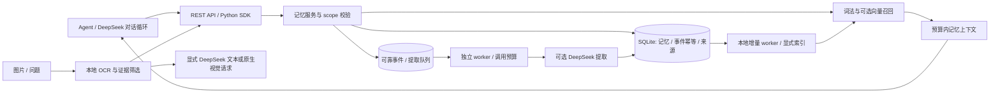

# 架构与选型决策

状态：v0.3，新增可恢复增量索引和图片证据。实际验证见 [验收记录](verification.md)。

## 目标与边界

Fishkeeping 是可被 agent 调用的记忆服务。提供 REST API、Python HTTP 客户端、示例与容器配置，调用方可以继续使用自己的 DeepSeek 对话循环。无需模型 key 即可启动。

| 决策 | 理由 | 代价与后续条件 |
| --- | --- | --- |
| Python 3.11+、FastAPI、Pydantic、HTTPX | 数据校验、OpenAPI、模型适配清晰 | 首版为同步接口，阻塞工作在线程池执行 |
| SQLite + WAL + 显式事务 | 零外部数据库，容易部署与备份 | 单机写入；规模扩展后迁移 PostgreSQL/vector store |
| 自行实现核心，不 fork 上游 | 保留小依赖面和稳定接入接口 | 需要自行维护生命周期、评测与迁移 |
| SQLite FTS5 + 本地多语言 MiniLM / 可选远程向量 | 先按完整 scope 检索再截断；本地向量无 API 费 | 词法分词仍为工程启发式；向量当前精确扫描 O(N×D)，尚无 ANN |
| 分层记忆、可解释衰减 | 能控制上下文预算与保留策略 | 工程启发式，需在真实任务上调参 |
| SQLite 持久队列 + 独立 worker | 先保存事件，提取可恢复；复用单机事务和备份 | 不承诺外部模型 exactly-once；未知结果需要人工决定重试 |
| 完整来源关系 + 分页 | 高频重复事实可积累超过 100 个来源 | 单次写入仍最多 100 个来源，响应只带 100 个预览 |

## 数据流

## 分类与生命周期

- `working`：带 session 的短期工作记忆，默认 1 小时过期。
- `episodic`：原始经历或对话片段，保留事实来源。
- `semantic`：显式事实、偏好，或通过模型从事件中提取的候选事实。
- `procedural`：明确记录的操作步骤。内容只是数据，不自动获得执行权限。

所有记录有 `namespace + user_id + agent_id` 三元 scope。会话过滤独立于 scope；检索同时可使用 session 内工作记忆和长期记忆。相同 scope、类型、会话、fact_key 和内容的重复写入不会增加重复记录；语义事实用显式 `fact_key` 保留更新历史，并归档旧事实的派生摘要。没有 fact_key 时，不伪装已解决自然语言矛盾。

检索组合相关度、重要性、近期性与衰减；无相关性时不因“很重要”返回随机记录。检索本身不强化记忆，只有显式 rehearsal 才强化，避免查询造成反馈循环。过期记录不可被普通检索读到；衰减仅影响排名，归档是显式维护操作，默认 dry-run。删除来源时必须处理其派生记忆，避免被遗忘的信息从衍生记录重新出现。

## 模型边界

`POST /v1/events` 在同一事务保存原始 episode、幂等记录和待提取任务后返回 202，无需等待模型。worker 在事务中领取租约和日预算，事务外调用模型，再在事务中校验租约、来源仍有效并提交事实与完成状态。429/5xx 有限退避；超时、网络结果未知、租约过期或提交失败均不会自动再次付费。API 不隐式启动 worker。

兼容的 `/v1/ingest` 仍先调用模型，再原子写入事件和事实；该路径失败不保存原始事件。两个接口共用业务 event ID 空间，不能用同一 ID 切换摄入模式。队列预算只限制 worker，显式 ingest、consolidate 及接入方聊天调用另行计费。

只由配置的固定服务地址发出模型请求，不允许请求体指定任意 URL。模型结果经过严格 schema 校验；空结果、截断、超时与不合法数据不写入。模型不能指定其他用户、namespace、记忆 ID 或直接操作数据库。原始对话作为不可信数据传入，模型提取不代表事实已被外部核实。

## 检索与存储演进

schema v2 在事务内迁移 v1：保留原数据并回填来源关系与 FTS5 索引。FTS 使用应用层 Unicode/CJK 分词后编码，避免 SQLite 再次切分中文词对。作用域、状态、有效期、类型和会话条件在候选截断前生效，旧记录不会因新记录过多而完全退出搜索。向量候选从同 scope 的全部已索引有效记录独立召回，然后与词法候选合并和重排。

向量索引由 `/v1/index` 或 CLI 明确构建，按条数、字符数和批次间时间预算限制；查询只编码 query。本地模型固定仓库 revision 与推理约定，按模型 key 隔离缓存；长文本分段后按 token 数加权均值，避免模型的 128-token 窗口静默丢弃尾部，但混合多个主题仍可能稀释语义。缺少缓存、缓存损坏和提供商故障都显式报告；可按 scope/model 重建缓存。

`sources` 表是来源关系的完整记录，记忆的 `source_ids` 为前 100 条预览，`source_count` 为完整计数；删除、循环检查和派生失效始终遍历完整关系。分页不是快照；并发追加时用稳定顺序继续读取，删除导致对象不存在时重新获取状态。

## 部署边界

独立 `index-worker` 以缺少当前模型缓存的有效记忆作为持久待办，租约与全库 UTC 记录预算在事务中保存；只允许本地编码。成功缓存即检查点，新写入和后台事实会在后续扫描发现。核心 schema 保持 v2，索引 worker 附加 schema 为 v1，详见 [增量工作流](research/incremental-index.md)。

图片 API 使用可选 CPU RapidOCR，只接受受限 PNG/JPEG 字节，不读取任意路径或 URL。图片哈希、EXIF 旋转后坐标、方法版本、置信信息和省略量随证据保存。问题筛选是词法启发式；`requires_review=false` 不保证全部所问字段都有证据。API 不启动付费模型；应用显式调用 `DeepSeekImageChat`，不自动重试或回退。

`/v1/images/events` 保存单一 tool 消息、关闭事实提取。原始请求身份哈希包含图片哈希、scope、session、问题、区域、task 和字符预算；相同请求读取持久证据，OCR 升级也不重新识别。不同请求共享 event ID 返回冲突，删除后墓碑阻止重放。确认后的事实通过 `source_ids` 引用图片 episode，继续使用完整来源和删除级联。原图不入数据库，调用方负责保留可审计文件。

默认仅监听回环地址。可通过 `FISHKEEPING_API_KEYS` 把 API key 绑定到 namespace；未配置认证只适合受信任本地环境。namespace 内 user/agent 由受信任调用方选择，业务网关仍须做用户授权。首版不承诺公网 SaaS、分布式扩展、加密静态存储或经过基准验证的召回质量。

## 研究记录

- [GitHub 项目比较](research/github-projects.md)
- [DeepSeek 与基础技术](research/deepseek-and-foundations.md)
