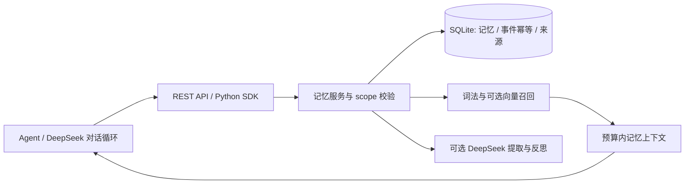

# 架构与选型决策

状态：首版已实现；2026-10-28 先完成资料记录，再开始源码实现。实际验证见 [验收记录](verification.md)。

## 目标与边界

Fishkeeping 是可被 agent 调用的记忆服务。提供 REST API、Python HTTP 客户端、示例与容器配置，调用方可以继续使用自己的 DeepSeek 对话循环。无需模型 key 即可启动。

| 决策 | 理由 | 代价与后续条件 |
| --- | --- | --- |
| Python 3.11+、FastAPI、Pydantic、HTTPX | 数据校验、OpenAPI、模型适配清晰 | 首版为同步接口，阻塞工作在线程池执行 |
| SQLite + WAL + 显式事务 | 零外部数据库，容易部署与备份 | 单机写入；规模扩展后迁移 PostgreSQL/vector store |
| 自行实现核心，不 fork 上游 | 保留小依赖面和稳定接入接口 | 需要自行维护生命周期、评测与迁移 |
| 中英文词法检索 + 可选远程向量 | 无 key 可运行，可升级语义能力 | 默认不具备跨语言同义词理解；线性候选扫描适合小规模 |
| 分层记忆、可解释衰减 | 能控制上下文预算与保留策略 | 工程启发式，需在真实任务上调参 |
| 显式巩固和来源链接 | 原始事件可审计，衍生内容可追踪 | 首版不做无人值守自动调度或知识图谱推断 |

## 数据流

## 分类与生命周期

- `working`：带 session 的短期工作记忆，默认 1 小时过期。
- `episodic`：原始经历或对话片段，保留事实来源。
- `semantic`：显式事实、偏好，或通过模型从事件中提取的候选事实。
- `procedural`：明确记录的操作步骤。内容只是数据，不自动获得执行权限。

所有记录有 `namespace + user_id + agent_id` 三元 scope。会话过滤独立于 scope；检索同时可使用 session 内工作记忆和长期记忆。相同 scope、类型、会话、fact_key 和内容的重复写入不会增加重复记录；语义事实用显式 `fact_key` 保留更新历史，并归档旧事实的派生摘要。没有 fact_key 时，不伪装已解决自然语言矛盾。

检索组合相关度、重要性、近期性与衰减；无相关性时不因“很重要”返回随机记录。检索本身不强化记忆，只有显式 rehearsal 才强化，避免查询造成反馈循环。过期记录不可被普通检索读到；衰减仅影响排名，归档是显式维护操作，默认 dry-run。删除来源时必须处理其派生记忆，避免被遗忘的信息从衍生记录重新出现。

## 模型边界

只由配置的固定服务地址发出模型请求，不允许请求体指定任意 URL。模型结果经过严格 schema 校验；空结果、截断、超时与不合法数据不写入。模型不能指定其他用户、namespace、记忆 ID 或直接操作数据库。原始对话作为不可信数据传入，模型提取不代表事实已被外部核实。

## 部署边界

默认仅监听回环地址。可通过 `FISHKEEPING_API_KEYS` 把 API key 绑定到 namespace；未配置认证只适合受信任本地环境。namespace 内 user/agent 由受信任调用方选择，业务网关仍须做用户授权。首版不承诺公网 SaaS、分布式扩展、加密静态存储或经过基准验证的召回质量。

## 研究记录

- [GitHub 项目比较](research/github-projects.md)
- [DeepSeek 与基础技术](research/deepseek-and-foundations.md)
